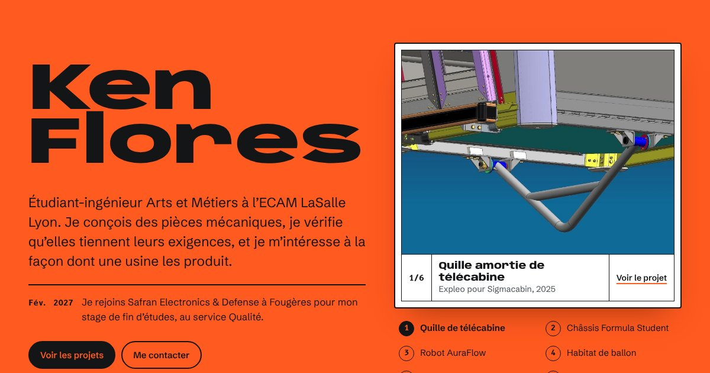

# Ken Flores, portfolio d'ingénieur

**Site : [ken38420.github.io/kenflores](https://ken38420.github.io/kenflores/)**

Étudiant-ingénieur Arts et Métiers à l'ECAM LaSalle Lyon (promotion 2027) : conception mécanique, qualité et industrie du futur, avec un semestre d'ingénierie aérospatiale au Politecnico di Milano. Stage de fin d'études chez Safran Electronics & Defense en 2027.

## Ce qu'on y trouve

- **7 projets**, chacun sur sa propre page avec une adresse partageable : quille de télécabine (Expleo), châssis de Formula Student, AuraFlow, habitat de ballon stratosphérique GEM-GCR (PoliSpace), mât rotor d'hélicoptère, ouvrages en acier (Fradem), KBE.
- **Un semestre à Milan** : quatre cours d'ingénierie aérospatiale et leurs projets.
- **Parcours et compétences** : frise formation / expériences, outils avec l'endroit où je m'en suis servi.

## Direction artistique

« Altitude » : un ciel de stratosphère bleu nuit pour les en-têtes, le quadrillage et le cartouche d'un bureau d'études, du verre dépoli là où quelque chose passe derrière, la typo Archivo en largeur étendue pour les titres. En tête de page, la vraie vue éclatée de l'habitat GEM-GCR, en trait blanc. **En arrivant sur l'accueil**, les sept projets tournent en maquettes 3D autour du nom au fil du défilement, puis se rangent en vitrine juste avant la section Projets. Ce sont des maquettes simplifiées, modélisées en code d'après les schémas et les cotes des projets (pas les fichiers CAO d'origine), rendues avec [Three.js](https://threejs.org) r170 (licence MIT), embarqué dans `assets/js/vendor/`. Sans WebGL 2, sur un écran trop bas, avec « réduire les animations » ou si le chargement échoue, le haut de page reste la vue éclatée GEM-GCR en dessin.

Le site suit le mode clair ou sombre du système et respecte la préférence « réduire les animations ».

## Organisation

Aucun outil de build : GitHub Pages sert les fichiers tels quels.

| Fichier | Rôle |
| --- | --- |
| `index.html` | Tout le contenu, découpé en vues (`data-view`) ; l'ancre de l'URL choisit la vue affichée |
| `assets/css/site.css` | Styles et tokens de couleur (clair, sombre, bandes de nuit) |
| `assets/js/site.js` | Navigation entre vues, vue éclatée, visionneuse d'images, copie de l'adresse |
| `assets/js/orbit.js` | Héros 3D de l'accueil : maquettes des projets, défilement, replis |
| `assets/img/`, `assets/video/` | Visuels tirés de mes rapports de stage et de projet |

Pour ajouter un projet, voir le commentaire en haut de `index.html`.

## Skills Claude utilisés

Le site a été retravaillé avec Claude Code et des skills de design, rangés dans [`.claude/skills`](.claude/skills/README.md) (non publiés sur le site).
